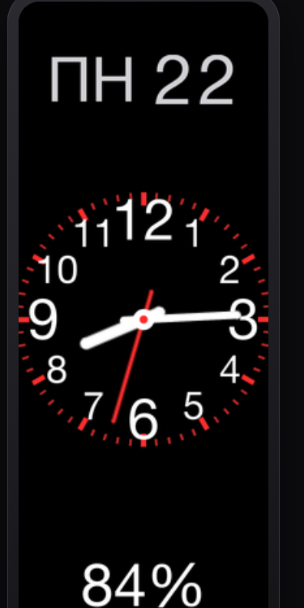

# Minimal Analog — Mi Band 9 watchface

> **Monorepo note:** the canonical compile path in this repo is
> `../miband9-face-packer/pack_face.py` (no Wine / `compile.exe`).
> Weekday source `2012` is **0=Sunday** (see `../docs/STATUS.md`).
> Agent context: `../AGENTS.md`, `../CLAUDE.md`, `../docs/CONTEXT.md`.

A minimalist analog watchface for the **Xiaomi Smart Band 9** (192 × 490 AMOLED), in
[Mi Create](https://github.com/ooflet/Mi-Create) `.fprj` format: a full analog dial with
all 12 numbers, a live date on top, and battery percentage at the bottom. Black background,
high‑contrast, with a low‑power Always‑On Display (AOD) variant.

<p align="center"></p>

> ⚠️ **Built entirely by Claude** (Anthropic's Claude Code). The human operator never read
> the code — every change to the project files was made by the model, then compiled and
> flashed. Treat it accordingly.

## Features

- Full analog dial: 12 numbers + minute ticks, smooth hour/minute hands, red second hand.
- Live **weekday + day** (top) and **battery %** (bottom), driven by the correct Mi Band 9
  data sources.
- **Battery colour by level**: white normally, **yellow ≤ 15%**, **red ≤ 5%**.
- **AOD variant** (dim, sparse, hour + minute only) that shares one rendering code path with
  the main face — tune a size/radius once and both follow.
- Pure-Python asset pipeline (Pillow) → `.fprj` → compiled `.bin`/`.face`.

## Install

Flash **`AnalogFull.face`** onto the band with the **Mi Fitness** app.

## Build

```sh
python3 -m venv venv && ./venv/bin/pip install Pillow
tools/rebuild.sh                 # render art → images/, rebuild AnalogFull.fprj + AOD/
```

Compile to `.face` with **this repo's packer** (canonical):

```sh
cd ../miband9-face-packer
python pack_face.py ../ejemplo-verificado AnalogFull.face --id 167210065
```

Historical upstream notes still mention Mi Create's `compile.exe` / Wine; do **not**
treat that as the primary path in this monorepo.

## More info

- **[DETAILS.md](DETAILS.md)** — full documentation: project layout, the `.fprj` widget
  format, Mi Band 9 data-source IDs, design constants, the AOD variant, and the macOS/Wine
  build recipe.
- Live preview: open `simulator.html` (served via `tools/devserver.py`) — a generic Mi Create
  face renderer that draws the real assets from `images/`.
- Format references: [Mi Create](https://github.com/ooflet/Mi-Create) ·
  [Mi Create docs](https://ooflet.github.io/docs) · [EasyFace](https://github.com/m0tral/EasyFace)
